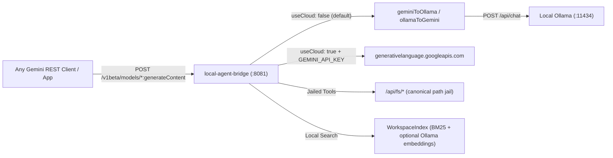

# local-agent-bridge

A **zero-dependency**, local-first Node.js HTTP bridge that turns any Gemini REST client into a local **Ollama** runner — complete with hot-swappable Local/Cloud routing, a workspace-jailed file API, hybrid BM25 + embedding RAG, and live SSE telemetry.

Built originally for the **MyOS** local AI environment so apps written for cloud Gemini SDKs can run 100% offline with zero code changes to your client.

---

## Architecture



---

## 30-Second Quickstart

Requires **Node.js >= 18** and **Ollama** running locally (no `npm install` needed).

```sh
git clone https://github.com/zakdegarmo/local-agent-bridge.git
cd local-agent-bridge
node bin/cli.js --workspace /path/to/your/project --model gemma4:latest
```

---

## Drop-In Gemini Usage Example

Point your Gemini REST endpoint from `https://generativelanguage.googleapis.com` to `http://127.0.0.1:8081`:

```js
const res = await fetch(
  'http://127.0.0.1:8081/v1beta/models/gemini-2.5-flash:generateContent',
  {
    method: 'POST',
    headers: { 'Content-Type': 'application/json' },
    body: JSON.stringify({
      systemInstruction: { parts: [{ text: 'Be concise.' }] },
      contents: [{ role: 'user', parts: [{ text: 'Explain signed distance fields in 2 lines.' }] }],
      generationConfig: { temperature: 0.4 },
    }),
  }
);

const geminiJson = await res.json();
console.log(geminiJson.candidates[0].content.parts[0].text);
```

Switch dynamically between local Ollama and cloud Gemini at runtime via `POST /api/config`:

```json
{ "useCloud": false, "activeModel": "qwen2.5-coder:7b" }
```

---

## API Reference

| Method | Endpoint | Description |
| :--- | :--- | :--- |
| `GET` | `/api/health` | Status, active mode (`local`/`cloud`), model, workspace root, and indexed doc count |
| `GET` / `POST` | `/api/config` | Read or update `{ useCloud, activeModel, embedModel }` (secrets never exposed) |
| `GET` | `/api/models` | List installed local models from Ollama `/api/tags` |
| `GET` | `/api/logs/stream` | Server-Sent Events (SSE) live bridge telemetry |
| `POST` | `/v1beta/models/*`, `/v1/models/*` | Drop-in Gemini REST proxy (translates to Ollama `/api/chat` in local mode) |
| `POST` | `/api/chat` | Direct chat endpoint with optional `useRag: true` workspace context injection |
| `POST` | `/api/fs/list` | List directory entries inside the workspace jail |
| `POST` | `/api/fs/read` | Read a UTF-8 file inside the workspace jail |
| `POST` | `/api/fs/write` | Write a UTF-8 file inside the workspace jail (creates parent dirs) |
| `POST` | `/api/rag/ingest` | Index text/code files under a jailed directory into `WorkspaceIndex` |
| `POST` | `/api/search` | Search indexed files (BM25 + optional Ollama embeddings) |
| `POST` | `/api/exec` | Execute workspace commands (disabled by default; requires `--enable-exec`) |

---

## Security Defaults

- **Localhost bind by default** (`127.0.0.1:8081`).
- **Strict Canonical Path Jail** (`resolveSafePath`): canonicalizes the workspace root and nearest existing target ancestor via `fs.realpathSync`, rejecting `..` traversal, out-of-root absolute paths, null bytes, and symlink escapes with `403`.
- **Shell Exec Disabled by Default**: `/api/exec` returns `403` unless started with `--enable-exec` or `ENABLE_EXEC=true`, and filters common destructive shell patterns.
- **Optional Bearer / API Key Auth**: Pass `--token <secret>` or set `BRIDGE_TOKEN` to enforce timing-safe auth on all routes except `/api/health`.
- **Secret Isolation**: `GEMINI_API_KEY` and `BRIDGE_TOKEN` are never returned by `/api/config` or `/api/health`.

---

## Run Tests

```sh
npm test
```

## License

MIT
